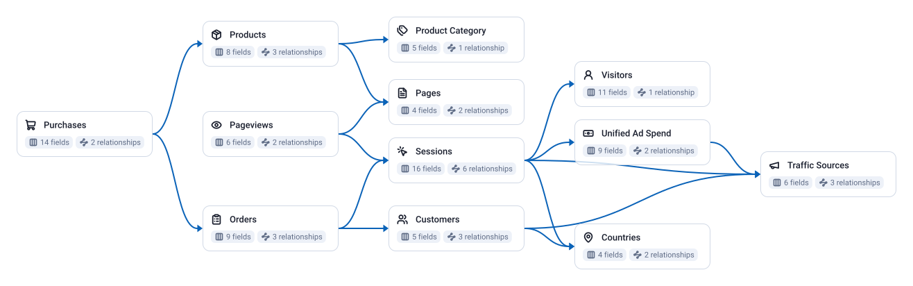

<!-- OWOX:GENERATED:START — regenerated on export, do not edit inside this block -->

**Authors:** [Vlad Flaks](https://github.com/vladflaks), [Rus Obolonsky](https://github.com/Obolrus)

| Data Mart | Fields |
|-----------|--------|
| [Countries](./countries.md) | 4 |
| [Customers](./customers.md) | 5 |
| [Orders](./orders.md) | 5 |
| [Pages](./pages.md) | 4 |
| [Pageviews](./pageviews.md) | 6 |
| [Product Category](./product-category.md) | 5 |
| [Products](./products.md) | 8 |
| [Purchases](./purchases.md) | 12 |
| [Sessions](./sessions.md) | 12 |
| [Traffic Sources](./traffic-sources.md) | 6 |
| [Unified Ad Spend](./unified-ad-spend.md) | 9 |
| [Visitors](./visitors.md) | 11 |

# Example Questions

- Which `traffic sources` and paid channels bring in the shoppers who actually convert, and what does each acquired `customer` cost versus the revenue they generate?
- How does the storefront funnel — `sessions` to `product views` to `orders` — convert, and where are the biggest drop-offs by `country`, `category` or landing `page`?
- Which `products` and `categories` drive the most revenue and repeat purchasing, and how does that shift across `countries` and over time?

# Explore this model

**[▶ Explore on canvas](https://model.owox.com/?okf=https://github.com/OWOX/models/tree/main/bundles/e-commerce)**

One click opens this model in a free OWOX canvas you can poke around in — no account needed.

<!-- OWOX:GENERATED:END -->

## Model preview

