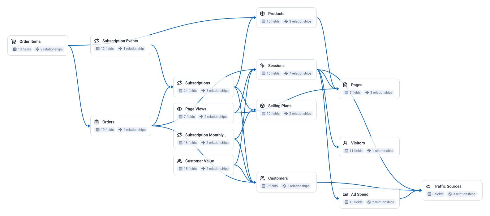

<!-- OWOX:GENERATED:START — regenerated on export, do not edit inside this block -->

**Authors:** [Vlad Flaks](https://github.com/vladflaks), [Rus Obolonsky](https://github.com/Obolrus)

| Data Mart | Fields |
|-----------|--------|
| [Ad Spend](./ad-spend.md) | 13 |
| [Customer Value](./customer-value.md) | 15 |
| [Customers](./customers.md) | 9 |
| [Order Items](./order-items.md) | 13 |
| [Orders](./orders.md) | 19 |
| [Page Views](./page-views.md) | 7 |
| [Pages](./pages.md) | 5 |
| [Products](./products.md) | 10 |
| [Selling Plans](./selling-plans.md) | 10 |
| [Sessions](./sessions.md) | 15 |
| [Subscription Events](./subscription-events.md) | 12 |
| [Subscription Monthly Snapshot](./subscription-monthly-snapshot.md) | 18 |
| [Subscriptions](./subscriptions.md) | 24 |
| [Traffic Sources](./traffic-sources.md) | 8 |
| [Visitors](./visitors.md) | 11 |

# Example Questions

- What share of revenue is recurring, how is it moving month over month, and which of new `subscriptions`, `plan changes` and cancellations is driving the change?
- How do subscriber cohorts retain over three, six and twelve months, and which delivery cadence and acquisition channel produce the stickiest subscribers?
- What does a new subscriber cost by channel, and how does that compare with the lifetime revenue they return — including the discount the `subscription programme` gives away?

# Explore this model

**[▶ Explore on canvas](https://model.owox.com/?okf=https://github.com/OWOX/models/tree/main/bundles/ecommerce-subscription-store)**

One click opens this model in a free OWOX canvas you can poke around in — no account needed.

<!-- OWOX:GENERATED:END -->

## Model preview

