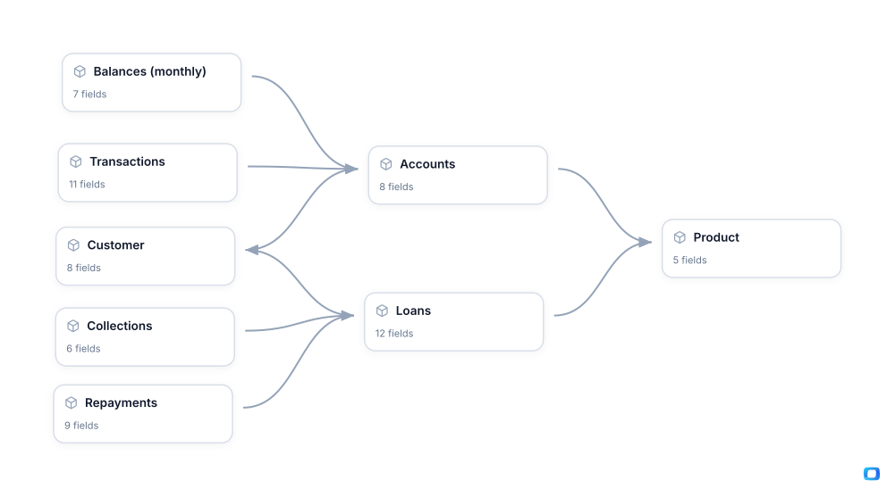

<!-- OWOX:GENERATED:START — regenerated on export, do not edit inside this block -->

**Authors:** [Vlad Flaks](https://github.com/vladflaks), [Rus Obolonsky](https://github.com/Obolrus)

| Data Mart | Fields |
|-----------|--------|
| [Accounts](./accounts.md) | 8 |
| [Balances (monthly)](./balances-monthly.md) | 7 |
| [Collections](./collections.md) | 6 |
| [Customer](./customer.md) | 8 |
| [Loans](./loans.md) | 12 |
| [Product](./product.md) | 5 |
| [Repayments](./repayments.md) | 9 |
| [Transactions](./transactions.md) | 11 |

# Example Questions

- Which acquisition channels bring in the most profitable borrowers once `late payments` and write-offs are taken into account?
- How much of the money lent out is the business likely to lose, and is that improving or worsening for recent `loans`?
- Do higher-risk `customers` who pay on time make up for the ones who default — is the pricing worth the risk?

# Explore this model

**[▶ Explore on canvas](https://model.owox.com/?okf=https://github.com/OWOX/models/tree/main/bundles/finance)**

One click opens this model in a free OWOX canvas you can poke around in — no account needed.

<!-- OWOX:GENERATED:END -->

## Model preview

