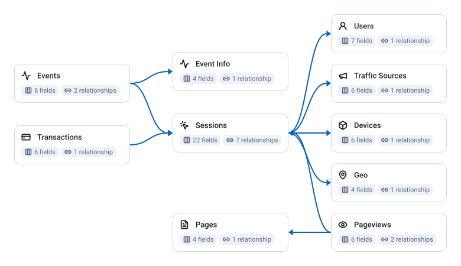

<!-- OWOX:GENERATED:START — regenerated on export, do not edit inside this block -->

| Data Mart | Fields | Description |
|-----------|--------|-------------|
| [Devices](./devices.md) | 6 | The device a session ran on: category, browser and its version, operating system and its version, one row per combination, as the GA 360 export records them. |
| [Event Info](./event-info.md) | 4 | The category, action and label behind event hits, one row per combination, as the site sent them. |
| [Events](./events.md) | 6 | Every event hit of the GA 360 export, one row each, tied to the session it fell in. |
| [Geo](./geo.md) | 4 | Where a session came from: country, region and city, one row per combination, as the GA 360 export records them. |
| [Pages](./pages.md) | 4 | The pages behind page views: host name, path and title, one row per combination. |
| [Pageviews](./pageviews.md) | 6 | Every page view hit of the GA 360 export, one row each, tied to the session it fell in. |
| [Sessions](./sessions.md) | 22 | One row per session of the GA 360 export, with its landing page, engagement, purchases and the keys to its location, device, traffic source and user. |
| [Traffic Sources](./traffic-sources.md) | 6 | The source, medium, campaign, keyword and ad content Google Analytics attributed a session to, one row per combination. |
| [Transactions](./transactions.md) | 6 | One row per purchase, deduplicated by transaction ID: when the export records the same ID more than once within the deduplication window (7 days in the runbook's setup), only the earliest is kept, so there is at most one row per ID per deduplication window. |
| [Users](./users.md) | 7 | The visitors behind sessions, one row per client ID: the identifier Google Analytics gives a browser, not a person. |

**SQL Transformation:** [the SQL that builds these tables, and how to run it](./references/sql-transformation/index.md)

# Example Questions

- Which sources and campaigns bring the `sessions` that end in a purchase?
- Which landing pages bring the most purchase revenue on mobile?
- Which `pages` do visitors from each country view most?

# Explore this model

**[▶ Explore on canvas](https://model.owox.com/?okf=https://github.com/OWOX/models/tree/main/bundles/ga360-standard)**

One click opens this model in a free OWOX canvas you can poke around in — no account needed.

<!-- OWOX:GENERATED:END -->

## Model preview

