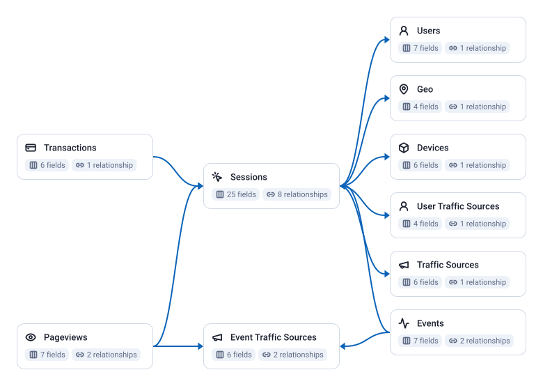

<!-- OWOX:GENERATED:START — regenerated on export, do not edit inside this block -->

| Data Mart | Fields | Description |
|-----------|--------|-------------|
| [Devices](./devices.md) | 6 | The device a session ran on: category, operating system and its version, browser and its version, one row per combination. |
| [Event Traffic Sources](./event-traffic-sources.md) | 6 | The traffic source GA4 records on a single event or page view, from its `source`, `medium`, `campaign`, `term` and `content` parameters: UTM tags, or GA4's own attribution such as `organic` or `referral`. |
| [Events](./events.md) | 7 | Every GA4 event other than a page view, one row each, tied to the session it fell in. |
| [Geo](./geo.md) | 4 | Where a session came from, as GA4 resolves it from the visitor's IP address: country, region and city, one row per combination. |
| [Pageviews](./pageviews.md) | 7 | Every GA4 `page_view` event, one row each, tied to the session it fell in. |
| [Sessions](./sessions.md) | 25 | One row per session as this model cuts it, with its landing page, engagement, purchases and keys to its source, device, location and user. |
| [Traffic Sources](./traffic-sources.md) | 6 | The source, medium, campaign, keyword and ad content a session is attributed to, one row per combination. |
| [Transactions](./transactions.md) | 6 | One row per purchase, deduplicated by its transaction ID: when GA4 records the same order more than once within the deduplication window (7 days in the runbook's setup), only the first is kept. |
| [User Traffic Sources](./user-traffic-sources.md) | 4 | How each user was first acquired: the source, medium and campaign GA4 records for the user's first visit, not for any later session. |
| [Users](./users.md) | 7 | The visitors behind sessions, one row per GA4 pseudo user ID: the identifier GA4 gives a browser or app instance, not a person. |

**SQL Transformation:** [the SQL that builds these tables, and how to run it](./references/sql-transformation/index.md)

# Example Questions

- Which sources and campaigns bring the `sessions` that end in a purchase?
- How does revenue per `session` differ between mobile and desktop, by country?
- On which visit do `users` make their first purchase?

# Explore this model

**[▶ Explore on canvas](https://model.owox.com/?okf=https://github.com/OWOX/models/tree/main/bundles/ga4-standard)**

One click opens this model in a free OWOX canvas you can poke around in — no account needed.

<!-- OWOX:GENERATED:END -->

## Model preview

