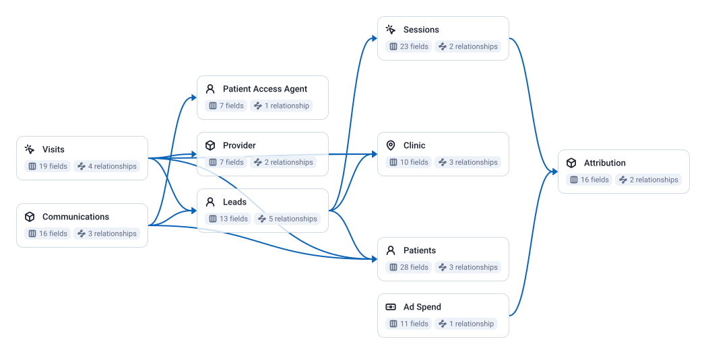

<!-- OWOX:GENERATED:START — regenerated on export, do not edit inside this block -->

**Authors:** [Vlad Flaks](https://github.com/vladflaks), [Rus Obolonsky](https://github.com/Obolrus)

| Data Mart | Fields |
|-----------|--------|
| [Ad Spend](./ad-spend.md) | 11 |
| [Attribution](./attribution.md) | 16 |
| [Clinic](./clinic.md) | 10 |
| [Communications](./communications.md) | 16 |
| [Leads](./leads.md) | 13 |
| [Patient Access Agent](./patient-access-agent.md) | 7 |
| [Patients](./patients.md) | 28 |
| [Provider](./provider.md) | 7 |
| [Sessions](./sessions.md) | 23 |
| [Visits](./visits.md) | 19 |

# Example Questions

- Which channels buy `patients` worth keeping rather than merely cheap ones — do the campaigns with the lowest cost per enquiry produce patients who return and accumulate real lifetime value, or ones who attend once and lapse?
- Does the contact centre change the outcome — do enquiries someone actually reached get booked and attended more often than the ones that went unanswered, and how many attempts is that worth?
- Where is capacity being lost, and what is it worth — how much revenue sits in no-shows and cancellations by location and specialty, and how much more sits in treatment that was planned and never delivered?

# Explore this model

**[▶ Explore on canvas](https://model.owox.com/?okf=https://github.com/OWOX/models/tree/main/bundles/healthcare-clinic-network)**

One click opens this model in a free OWOX canvas you can poke around in — no account needed.

<!-- OWOX:GENERATED:END -->

## Model preview

