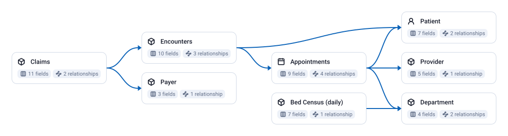

<!-- OWOX:GENERATED:START — regenerated on export, do not edit inside this block -->

**Authors:** [Vlad Flaks](https://github.com/vladflaks), [Rus Obolonsky](https://github.com/Obolrus)

| Data Mart | Fields |
|-----------|--------|
| [Appointments](./appointments.md) | 9 |
| [Bed Census (daily)](./bed-census-daily.md) | 7 |
| [Claims](./claims.md) | 11 |
| [Department](./department.md) | 4 |
| [Encounters](./encounters.md) | 10 |
| [Patient](./patient.md) | 7 |
| [Payer](./payer.md) | 3 |
| [Provider](./provider.md) | 5 |

# Example Questions

- How does no-show rate vary by booking lead time and insurance type, and what would tightening scheduling windows save in lost capacity?
- What is the `claim` denial rate by `payer`, and how much longer do denied claims sit in accounts receivable than clean claims?
- Which `departments` are running closest to `bed capacity`, and how does occupancy move through the week and across the year?

# Explore this model

**[▶ Explore on canvas](https://model.owox.com/?okf=https://github.com/OWOX/models/tree/main/bundles/healthcare)**

One click opens this model in a free OWOX canvas you can poke around in — no account needed.

<!-- OWOX:GENERATED:END -->

## Model preview

