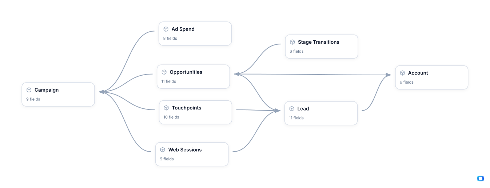

<!-- OWOX:GENERATED:START — regenerated on export, do not edit inside this block -->

**Authors:** [Vlad Flaks](https://github.com/vladflaks), [Rus Obolonsky](https://github.com/Obolrus)

| Data Mart | Fields |
|-----------|--------|
| [Account](./account.md) | 6 |
| [Ad Spend](./ad-spend.md) | 8 |
| [Campaign](./campaign.md) | 9 |
| [Campaign Performance](./campaign-performance.md) | 11 |
| [Lead](./lead.md) | 11 |
| [Opportunities](./opportunities.md) | 11 |
| [Stage Transitions](./stage-transitions.md) | 6 |
| [Touchpoints](./touchpoints.md) | 10 |
| [Web Sessions](./web-sessions.md) | 9 |

# Example Questions

- Which channels and `campaigns` generate the most pipeline and revenue once `ad spend`, attribution credit and win rates are accounted for?
- Where does the funnel leak most — awareness to `lead`, lead to MQL/SQL, or `opportunity` to close — and does that differ by channel?
- Do target (ABM) `accounts` convert, close and win at a higher rate than the rest of the book?

# Explore this model

**[▶ Explore on canvas](https://model.owox.com/?okf=https://github.com/OWOX/models/tree/main/bundles/marketing-leadgen)**

One click opens this model in a free OWOX canvas you can poke around in — no account needed.

<!-- OWOX:GENERATED:END -->

## Model preview

