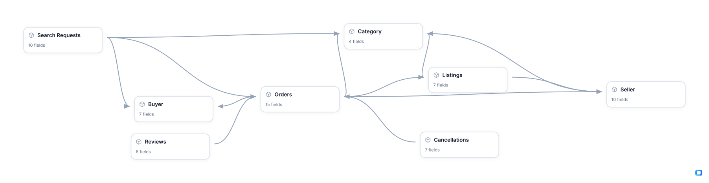

<!-- OWOX:GENERATED:START — regenerated on export, do not edit inside this block -->

**Authors:** [Vlad Flaks](https://github.com/vladflaks), [Rus Obolonsky](https://github.com/Obolrus)

| Data Mart | Fields |
|-----------|--------|
| [Buyer](./buyer.md) | 7 |
| [Cancellations](./cancellations.md) | 7 |
| [Category](./category.md) | 4 |
| [Listings](./listings.md) | 7 |
| [Orders](./orders.md) | 15 |
| [Reviews](./reviews.md) | 6 |
| [Search Requests](./search-requests.md) | 10 |
| [Seller](./seller.md) | 10 |

# Example Questions

- Where is liquidity weakest — which `categories` have `buyers` searching but too little live supply to fill the demand?
- Is take-rate optimisation costing us supply, with `sellers` in our highest-commission `categories` going dormant faster than the rest?
- How much of our booked GMV never settles, and do `cancellations` and complaints concentrate around the same `sellers`?

# Explore this model

**[▶ Explore on canvas](https://model.owox.com/?okf=https://github.com/OWOX/models/tree/main/bundles/marketplace)**

One click opens this model in a free OWOX canvas you can poke around in — no account needed.

<!-- OWOX:GENERATED:END -->

## Model preview

