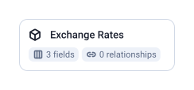

1 tables, 3 fields, 0 joins.

| Data Mart | Fields | Description |
|-----------|--------|-------------|
| [Exchange Rates](./exchange-rates.md) | 3 | Daily foreign exchange rates from Bank of Canada. |

# Example Questions

- What was the US dollar worth in Canadian dollars on each day of the last year?
- Which currencies moved the most against the Canadian dollar this month?
- How would last quarter's foreign-currency sales look converted to Canadian dollars at the rate of each sale's date?

# Explore this model

**[▶ Explore on canvas](https://model.owox.com/?okf=https://github.com/OWOX/models/tree/main/bundles/sources/bank-of-canada)**

One click opens this model in a free OWOX canvas you can poke around in — no account needed.

## Model preview

