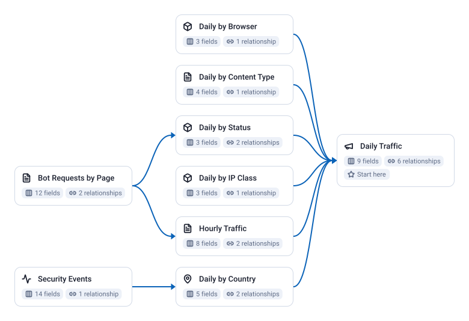

<!-- OWOX:GENERATED:START — regenerated on export, do not edit inside this block -->

| Data Mart | Fields | Description |
|-----------|--------|-------------|
| [Bot Requests by Page](./bot-requests-by-page.md) | 12 | Requests from bots and AI crawlers to one host, seen at Cloudflare's edge: one row per UTC hour, page path, method, user agent, status, content type and verified-bot category, with no IP addresses. |
| [Daily Traffic](./daily-traffic.md) | 9 | The zone's exact daily totals from Cloudflare's daily rollup: requests, page views, unique client IPs, bytes, cached requests and bytes, threats and encrypted requests. |
| [Daily by Browser](./daily-by-browser.md) | 3 | The zone's exact daily page views by browser family, as Cloudflare reads the user agent. |
| [Daily by Content Type](./daily-by-content-type.md) | 4 | The zone's exact daily requests and bytes by response content type: html, md, js, css, images, and empty for redirects. |
| [Daily by Country](./daily-by-country.md) | 5 | The zone's exact daily requests, bytes and threats by client country. |
| [Daily by IP Class](./daily-by-ip-class.md) | 3 | The zone's exact daily requests by Cloudflare's IP class: searchEngine, badHost, tor, allowlist, monitoringService, unknown and others. |
| [Daily by Status](./daily-by-status.md) | 3 | The zone's exact daily requests by HTTP status code, from the daily rollup. |
| [Hourly Traffic](./hourly-traffic.md) | 8 | The zone's exact hourly totals from Cloudflare's hourly rollup: requests, page views, unique client IPs, bytes, cached requests and threats. |
| [Security Events](./security-events.md) | 14 | Requests Cloudflare blocked, challenged or logged under a security rule: WAF managed rules, the browser integrity check, the security level and others. |

# Example Questions

- Which pages do AI crawlers read most, and which crawlers does Cloudflare verify and which only claim a bot name?
- Did 404s or `security events` grow this month, and from which countries and rules?
- What share of the zone's daily requests is served from cache, and how does it change by hour?

# Explore this model

**[▶ Explore on canvas](https://model.owox.com/?okf=https://github.com/OWOX/models/tree/main/bundles/sources/cloudflare-analytics)**

One click opens this model in a free OWOX canvas you can poke around in — no account needed.

<!-- OWOX:GENERATED:END -->

## Model preview

