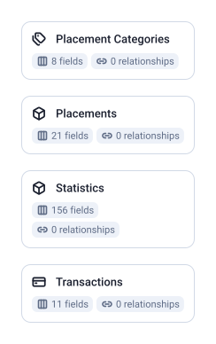

4 tables, 196 fields, 0 joins.

| Data Mart | Fields | Description |
|-----------|--------|-------------|
| [Placement Categories](./placement-categories.md) | 8 | Performance metrics broken down by content category. |
| [Placements](./placements.md) | 21 | Performance metrics broken down by publisher placement. |
| [Statistics](./statistics.md) | 156 | Statistics and metrics for Criteo advertising campaigns. |
| [Transactions](./transactions.md) | 11 | Transaction-level data with individual order details attributed to Criteo ads. |

# Example Questions

- Which campaigns and adsets spend the most for the fewest attributed sales?
- How do post-click and post-view sales compare, and how do their windows change the answer?
- Which publisher placements and content categories bring the most clicks and sales?

# Explore this model

**[▶ Explore on canvas](https://model.owox.com/?okf=https://github.com/OWOX/models/tree/main/bundles/sources/criteo-ads)**

One click opens this model in a free OWOX canvas you can poke around in — no account needed.

## Model preview

