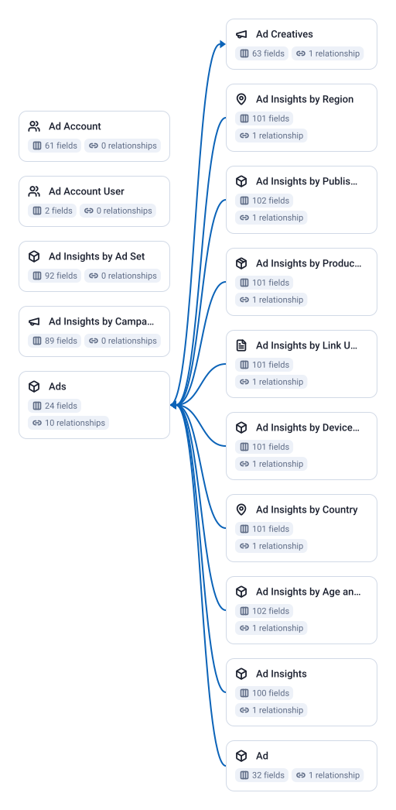

15 tables, 1172 fields, 10 joins.

| Data Mart | Fields | Description |
|-----------|--------|-------------|
| [Ad](./ad.md) | 32 | Individual ads with their creative, status, and links to their campaign and ad set. |
| [Ad Account](./ad-account.md) | 61 | Your ad account settings, status, currency, and billing details. |
| [Ad Account User](./ad-account-user.md) | 2 | Users with access to an ad account and their assigned roles. |
| [Ad Creatives](./ad-creatives.md) | 63 | The images, videos, text, and other visual elements used in your ads. |
| [Ad Insights](./ad-insights.md) | 100 | Daily performance metrics for each ad — impressions, clicks, spend, and conversions. |
| [Ad Insights by Ad Set](./ad-insights-by-ad-set.md) | 92 | Daily ad set performance with reach deduplicated to match Meta Ads Manager. |
| [Ad Insights by Age and Gender](./ad-insights-by-age-and-gender.md) | 102 | Daily ad performance broken down by audience age range and gender. |
| [Ad Insights by Campaign](./ad-insights-by-campaign.md) | 89 | Daily campaign performance with reach deduplicated to match Meta Ads Manager. |
| [Ad Insights by Country](./ad-insights-by-country.md) | 101 | Daily ad performance broken down by the country where your audience is located. |
| [Ad Insights by Device Platform](./ad-insights-by-device-platform.md) | 101 | Daily ad performance broken down by the device type your audience used. |
| [Ad Insights by Link URL Asset](./ad-insights-by-link-url-asset.md) | 101 | Daily ad performance broken down by the link URL shown in your ads. |
| [Ad Insights by Product ID](./ad-insights-by-product-id.md) | 101 | Daily ad performance broken down by individual product from your catalog. |
| [Ad Insights by Publisher Platform and Position](./ad-insights-by-publisher-platform-and-position.md) | 102 | Daily ad performance broken down by where your ads appeared — platform and placement position. |
| [Ad Insights by Region](./ad-insights-by-region.md) | 101 | Daily ad performance broken down by the region where your audience is located. |
| [Ads](./ads.md) | 24 | Individual ads with their status, creative, and campaign hierarchy. |

# Example Questions

- Which campaigns spend the most for the fewest results, once spend is divided by results?
- Which creatives drive the cheapest conversions, once performance is joined to the creative each ad runs?
- How many people did each campaign reach, and how often did they see the ads?

# Explore this model

**[▶ Explore on canvas](https://model.owox.com/?okf=https://github.com/OWOX/models/tree/main/bundles/sources/facebook-ads)**

One click opens this model in a free OWOX canvas you can poke around in — no account needed.

## Model preview

