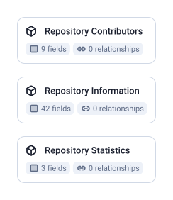

3 tables, 54 fields, 0 joins.

| Data Mart | Fields | Description |
|-----------|--------|-------------|
| [Repository Contributors](./repository-contributors.md) | 9 | Contains list of contributors to the repository with their contribution counts |
| [Repository Information](./repository-information.md) | 42 | Contains detailed repository information and statistics |
| [Repository Statistics](./repository-statistics.md) | 3 | Contains daily repository statistics including stars and contributors count |

# Example Questions

- How have stars and contributors grown, day by day?
- Who contributes most to the repository, and are they people or bots?
- Which license, language and default branch does the repository have, and how active is it (open issues, last push)?

# Explore this model

**[▶ Explore on canvas](https://model.owox.com/?okf=https://github.com/OWOX/models/tree/main/bundles/sources/github)**

One click opens this model in a free OWOX canvas you can poke around in — no account needed.

## Model preview

