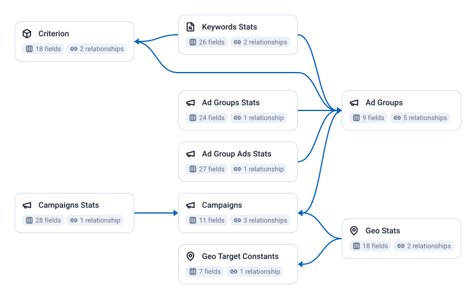

<!-- OWOX:GENERATED:START — regenerated on export, do not edit inside this block -->

**Authors:** [Ievgen Krasovytskyi](https://github.com/ikrasovytskyi)

| Data Mart | Fields | Last updated | Description |
|-----------|--------|--------------|-------------|
| [Ad Group Ads Stats](./ad-group-ads-stats.md) | 27 | 2026-09-28 | Daily performance of each ad: impressions, clicks, cost, conversions and conversion value, with the ad's type, name, status and final URLs. |
| [Ad Groups](./ad-groups.md) | 9 | 2026-08-06 | One row per ad group: its name, status and type, the campaign it sits in, and its CPC, CPM and target CPA bids. |
| [Ad Groups Stats](./ad-groups-stats.md) | 24 | 2026-08-06 | Daily ad group performance: impressions, clicks, cost, conversions and conversion value, with interaction and engagement ratios. |
| [Campaigns](./campaigns.md) | 11 | 2026-08-07 | One row per campaign: its name, status, advertising channel type and sub type, bidding strategy, budget, target CPA or target ROAS, and start and end dates. |
| [Campaigns Stats](./campaigns-stats.md) | 28 | 2026-08-07 | Daily campaign performance: impressions, clicks, cost, conversions and conversion value, with ratios such as click-through rate and cost per conversion, and for search campaigns the share of impressions won or lost to budget and to ad rank. |
| [Criterion](./criterion.md) | 18 | 2026-09-28 | One row per targeting criterion of an ad group: keywords, placements and negative exclusions, with their type, status, bids, quality score, final URLs and estimated first-page and top-of-page bids. |
| [Geo Stats](./geo-stats.md) | 18 | 2026-08-06 | Daily campaign performance by country and by how the location was matched: impressions, clicks, cost, conversions and conversion value. |
| [Geo Target Constants](./geo-target-constants.md) | 7 | 2026-08-06 | A reference table of Google's geographic targets: the English name, the fully qualified name, the ISO country code, the target type and status, and the parent target. |
| [Keywords Stats](./keywords-stats.md) | 26 | 2026-08-06 | Daily keyword performance: impressions, clicks, cost, conversions and conversion value, the keyword's text, match type and status, its quality score, and search impression share and top-of-page rates. |

# Example Questions

- Which `campaigns` spend the most for the fewest conversions, once cost is divided by conversions?
- How does cost per conversion change from `campaign` to `ad group` to keyword for the same budget?
- Which countries do `campaigns` spend in, and which of them convert?

# Explore this model

**[▶ Explore on canvas](https://model.owox.com/?okf=https://github.com/OWOX/models/tree/main/bundles/sources/google-ads)**

One click opens this model in a free OWOX canvas you can poke around in — no account needed.

<!-- OWOX:GENERATED:END -->

## Model preview

