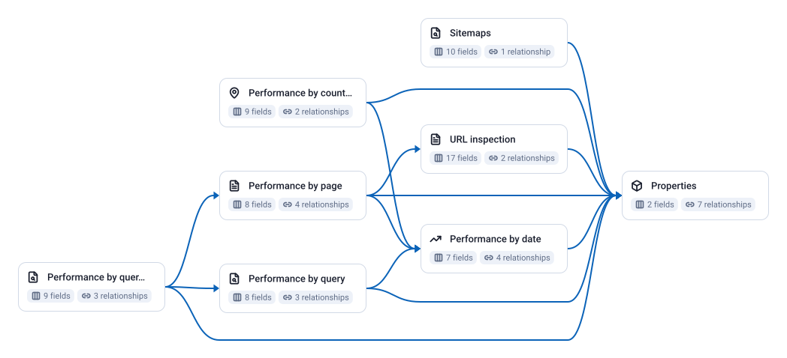

<!-- OWOX:GENERATED:START — regenerated on export, do not edit inside this block -->

**Authors:** [Ievgen Krasovytskyi](https://github.com/ikrasovytskyi)

| Data Mart | Fields | Description |
|-----------|--------|-------------|
| [Performance by country and device](./performance-by-country-and-device.md) | 9 | Daily clicks, impressions, CTR and position per country (ISO 3166-1 alpha-3) and device (DESKTOP, MOBILE, TABLET). |
| [Performance by date](./performance-by-date.md) | 7 | Daily clicks, impressions, CTR and average position for the whole property and one search type, the same totals the Performance report header shows. |
| [Performance by page](./performance-by-page.md) | 8 | Daily clicks, impressions, CTR and position per landing URL (the final URL after redirects). |
| [Performance by query](./performance-by-query.md) | 8 | Daily clicks, impressions, CTR and position per search query, paged at 25,000 rows so the long tail Google exposes is loaded, not the 1,000 rows the interface exports. |
| [Performance by query and page](./performance-by-query-and-page.md) | 9 | Daily clicks, impressions, CTR and position for every query and landing page pair: which URL Google showed for which query. |
| [Properties](./properties.md) | 2 | The Search Console properties the connected Google account can read, with its permission level. |
| [Sitemaps](./sitemaps.md) | 10 | Sitemaps submitted for the property: last submitted and last downloaded times, pending state, type, and Google's counts of warnings and errors, with per-content-type submitted and indexed counts as JSON. |
| [URL inspection](./url-inspection.md) | 17 | Current index status of the URLs listed in the connector's URLs to inspect parameter: verdict, coverage state, indexing and robots.txt state, last crawl, Google's canonical versus the declared one, mobile-usability and rich-results verdicts. |

# Example Questions

- Is organic traffic down because impressions fell, position worsened or CTR dropped, and on which pages did it happen?
- Which queries sit at position 11 to 20 with the most impressions, and which pages does Google show for them?
- How large is the anonymised share, the gap between the day totals and the sum of the per-query rows for the same days?

# Explore this model

**[▶ Explore on canvas](https://model.owox.com/?okf=https://github.com/OWOX/models/tree/main/bundles/sources/google-search-console)**

One click opens this model in a free OWOX canvas you can poke around in — no account needed.

<!-- OWOX:GENERATED:END -->

## Model preview

