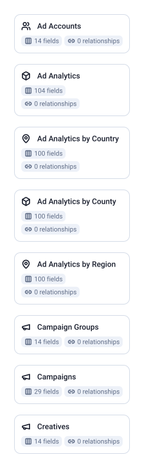

5 tables, 175 fields, 0 joins.

| Data Mart | Fields | Description |
|-----------|--------|-------------|
| [Ad Accounts](./ad-accounts.md) | 14 | Your ad account settings, billing details, currency, and account status. |
| [Ad Analytics](./ad-analytics.md) | 104 | Daily performance metrics for your campaigns — impressions, clicks, spend, and conversions. |
| [Campaign Groups](./campaign-groups.md) | 14 | Top-level containers that group campaigns with shared objectives, budgets, and scheduling. |
| [Campaigns](./campaigns.md) | 29 | Individual campaigns defining your targeting, ad format, bid strategy, and budget. |
| [Creatives](./creatives.md) | 14 | The visual and copy elements of your ads shown to members across LinkedIn. |

# Example Questions

- Which campaigns are active, and which objective type does each pursue?
- How do impressions, clicks and cost in local currency move day by day across the account?
- Which creatives are meant to be active but are not serving, and why?

# Explore this model

**[▶ Explore on canvas](https://model.owox.com/?okf=https://github.com/OWOX/models/tree/main/bundles/sources/linkedin-ads)**

One click opens this model in a free OWOX canvas you can poke around in — no account needed.

## Model preview

