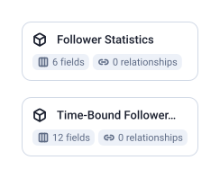

2 tables, 18 fields, 0 joins.

| Data Mart | Fields | Description |
|-----------|--------|-------------|
| [Follower Statistics](./follower-statistics.md) | 6 | Lifetime follower counts broken down by segment — seniority, industry, function, geography, and association type. |
| [Time-Bound Follower Statistics](./time-bound-follower-statistics.md) | 12 | Daily follower gains broken down by organic and paid — tracks how your audience grows over time. |

# Example Questions

- Which seniority levels, industries and countries do the page's followers come from?
- How many followers does the page gain per week, organic and paid?
- How does the follower mix change over time as the page grows?

# Explore this model

**[▶ Explore on canvas](https://model.owox.com/?okf=https://github.com/OWOX/models/tree/main/bundles/sources/linkedin-pages)**

One click opens this model in a free OWOX canvas you can poke around in — no account needed.

## Model preview

