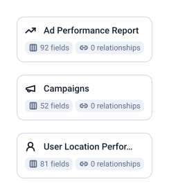

3 tables, 225 fields, 0 joins.

| Data Mart | Fields | Description |
|-----------|--------|-------------|
| [Ad Performance Report](./ad-performance-report.md) | 92 | Daily ad performance — impressions, clicks, spend, and conversions segmented by device, network, and match type. |
| [Campaigns](./campaigns.md) | 52 | Your campaign and ad group structure — type, status, bid strategy, budget, and keyword settings. |
| [User Location Performance Report](./user-location-performance-report.md) | 81 | Daily performance by user physical location — impressions, clicks, spend, and conversions broken down by country, state, and city. |

# Example Questions

- Which campaigns are active, and which bid strategy type does each use?
- How do spend and qualified conversions differ between devices and networks?
- Which countries and cities bring the most clicks, and which of them convert?

# Explore this model

**[▶ Explore on canvas](https://model.owox.com/?okf=https://github.com/OWOX/models/tree/main/bundles/sources/microsoft-ads)**

One click opens this model in a free OWOX canvas you can poke around in — no account needed.

## Model preview

