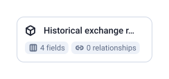

1 tables, 4 fields, 0 joins.

| Data Mart | Fields | Description |
|-----------|--------|-------------|
| [Historical exchange rates data](./historical-exchange-rates-data.md) | 4 | Contains historical exchange rates for different currencies relative to a base currency |

# Example Questions

- What was one US dollar worth in euros on each day of the last year?
- Which currencies changed the most against the base currency over the last 30 days?
- How would last quarter's orders look converted to a single currency at the rate of each order's date?

# Explore this model

**[▶ Explore on canvas](https://model.owox.com/?okf=https://github.com/OWOX/models/tree/main/bundles/sources/open-exchange-rates)**

One click opens this model in a free OWOX canvas you can poke around in — no account needed.

## Model preview

