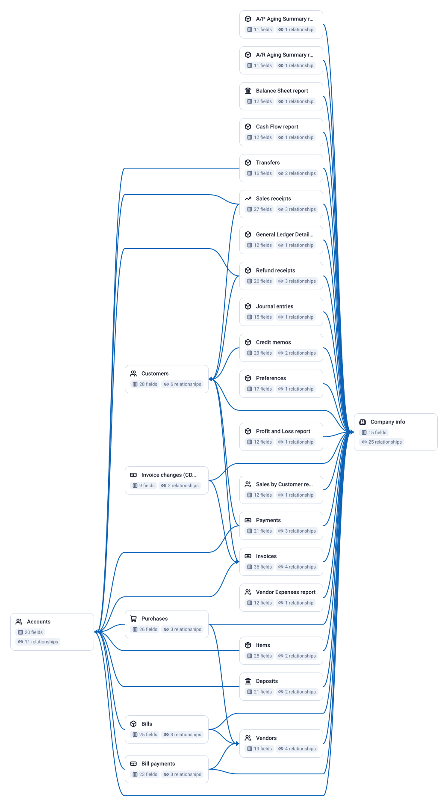

26 tables, 486 fields, 48 joins.

| Data Mart | Fields | Description |
|-----------|--------|-------------|
| [A/P Aging Summary report](./a-p-aging-summary-report.md) | 11 | A/P Aging Summary as of report_date (window end): one row per vendor with aging buckets. |
| [A/R Aging Summary report](./a-r-aging-summary-report.md) | 11 | A/R Aging Summary as of report_date (window end): one row per customer with Current, 1-30, 31-60, 61-90, 91+ and Total columns. |
| [Accounts](./accounts.md) | 20 | Chart of accounts, active and inactive. |
| [Balance Sheet report](./balance-sheet-report.md) | 12 | Balance Sheet as of the run window end (Assets, Liabilities, Equity by account). |
| [Bill payments](./bill-payments.md) | 23 | Payments against vendor bills; joins to Bill through Line[].LinkedTxn. |
| [Bills](./bills.md) | 25 | Vendor bills (payables). |
| [Cash Flow report](./cash-flow-report.md) | 12 | Statement of Cash Flows for the run window. |
| [Company info](./company-info.md) | 15 | One row per company: names, country, fiscal-year start. |
| [Credit memos](./credit-memos.md) | 23 | Credits issued to customers (reduce receivables; negative revenue in reconciliations). |
| [Customers](./customers.md) | 28 | Customers, including inactive ones and sub-customers, with open balance and a flattened billing address. |
| [Deposits](./deposits.md) | 21 | Bank deposits, including the ones that group undeposited customer payments. |
| [General Ledger Detail report](./general-ledger-detail-report.md) | 12 | General Ledger: every posting line per account for the run window, with opening balance and totals. |
| [Invoice changes (CDC, incl. deletes)](./invoice-changes-cdc-incl-deletes.md) | 9 | Change data capture for Invoice: every invoice created, updated or deleted since the run window start, full payload, deleted ones with status = Deleted. |
| [Invoices](./invoices.md) | 36 | Invoices with header amounts, customer and Line[] as JSON (SalesItemLineDetail.ItemRef, Qty, UnitPrice, Amount). |
| [Items](./items.md) | 25 | Products and services with price, purchase cost and the three account links. |
| [Journal entries](./journal-entries.md) | 15 | Manual and adjusting journal entries; the postings the transaction tables miss. |
| [Payments](./payments.md) | 21 | Customer payments. |
| [Preferences](./preferences.md) | 17 | One row per company: home currency, multi-currency flag, fiscal-year and tracking settings. |
| [Profit and Loss report](./profit-and-loss-report.md) | 12 | Profit and Loss per run window, one column per month (summarize_column_by=Month), rows nested by account group. |
| [Purchases](./purchases.md) | 26 | Expenses paid directly (cash, check, card) without a bill. |
| [Refund receipts](./refund-receipts.md) | 26 | Money refunded to customers. |
| [Sales by Customer report](./sales-by-customer-report.md) | 12 | Sales by Customer Summary for the run window. |
| [Sales receipts](./sales-receipts.md) | 27 | Sales paid at the time of sale (no receivable). |
| [Transfers](./transfers.md) | 16 | Money moved between balance-sheet accounts. |
| [Vendor Expenses report](./vendor-expenses-report.md) | 12 | Expenses by Vendor for the run window. |
| [Vendors](./vendors.md) | 19 | Vendors, including inactive ones, with open payable balance. |

# Example Questions

- How much cash is on hand against the bills due this month, once bank `accounts`, open `bills` and overdue `invoices` are joined?
- Which `customers` are overdue, by how much and for how long, and how long do they usually take to pay?
- Does the profit and loss rebuilt from `invoices`, `bills` and `purchases` match the report QuickBooks produces for the same months, and where does it differ?

# Explore this model

**[▶ Explore on canvas](https://model.owox.com/?okf=https://github.com/OWOX/models/tree/main/bundles/sources/quickbooks)**

One click opens this model in a free OWOX canvas you can poke around in — no account needed.

## Model preview

