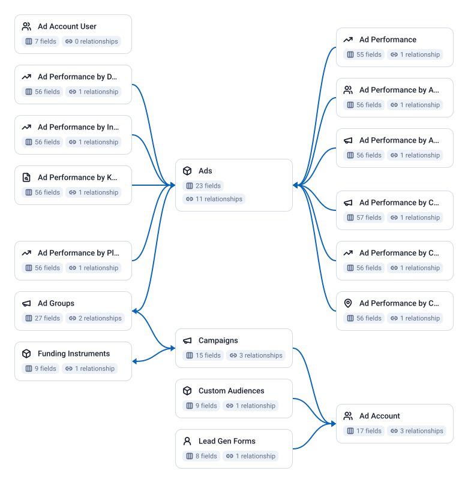

<!-- OWOX:GENERATED:START — regenerated on export, do not edit inside this block -->

**Authors:** [Ievgen Krasovytskyi](https://github.com/ikrasovytskyi)

| Data Mart | Fields | Last updated | Description |
|-----------|--------|--------------|-------------|
| [Ad Account](./ad-account.md) | 17 | 2026-05-29 | One row per ad account the connector is configured for: its name, type, currency, time zone, the click and view attribution windows, the business it belongs to, the primary contact member, and the account-level excluded communities and keywords. |
| [Ad Account User](./ad-account-user.md) | 7 | 2026-05-29 | The Reddit Ads user the connector authenticates as: the member ID, first and last name, email, phone, and the linked Reddit user ID and username. |
| [Ad Groups](./ad-groups.md) | 27 | 2026-05-29 | One row per ad group: its name, the campaign and ad account it sits in, configured and effective status, bid strategy, bid type and bid value, goal type and value, optimization goal, start and end time, schedule, targeting, and whether it belongs to a campaign-budget-optimization campaign. |
| [Ad Performance](./ad-performance.md) | 55 | 2026-05-29 | Daily ad performance with no breakdown beyond the ad: one row per ad per `date`. |
| [Ad Performance by Account](./ad-performance-by-account.md) | 56 | 2026-05-29 | Daily ad performance with the ad account as the breakdown: one row per ad per `date` per `account_id`. |
| [Ad Performance by Ad Group](./ad-performance-by-ad-group.md) | 56 | 2026-05-29 | Daily ad performance with the ad group as the breakdown: one row per ad per `date` per `ad_group_id`. |
| [Ad Performance by Campaign](./ad-performance-by-campaign.md) | 57 | 2026-05-29 | Daily ad performance with the campaign as the breakdown: one row per ad per `date` per `campaign_id`. |
| [Ad Performance by Community](./ad-performance-by-community.md) | 56 | 2026-05-29 | Daily ad performance split by community (subreddit): one row per ad per `date` per `community`. |
| [Ad Performance by Country](./ad-performance-by-country.md) | 56 | 2026-05-29 | Daily ad performance split by country: one row per ad per `date` per `country`. |
| [Ad Performance by DMA](./ad-performance-by-dma.md) | 56 | 2026-05-29 | Daily ad performance split by Designated Market Area (DMA): one row per ad per `date` per `dma`. |
| [Ad Performance by Interest](./ad-performance-by-interest.md) | 56 | 2026-05-29 | Daily ad performance split by the interest the audience was targeted by: one row per ad per `date` per `interest`. |
| [Ad Performance by Keyword](./ad-performance-by-keyword.md) | 56 | 2026-05-29 | Daily ad performance split by keyword: one row per ad per `date` per `keyword`. |
| [Ad Performance by Placement](./ad-performance-by-placement.md) | 56 | 2026-05-29 | Daily ad performance split by placement of the creative: one row per ad per `date` per `placement`. |
| [Ads](./ads.md) | 24 | 2026-09-28 | One row per ad: its name, type, configured and effective status, the ad group, campaign and ad account it belongs to, the click URL, the post it promotes, a preview URL and its expiry, the rejection reason if it was rejected, event trackers and, for shopping ads, products and the creative. |
| [Campaigns](./campaigns.md) | 15 | 2026-05-29 | One row per campaign: its name, objective, configured and effective status, spend cap, goal type and value, the funding instrument paying for it, special ad categories, the app it promotes (for app install campaigns) and creation and modification times. |
| [Custom Audiences](./custom-audiences.md) | 9 | 2026-05-29 | One row per custom audience of an ad account: its name, type, processing status, the estimated size as a lower and an upper bound, and creation and modification times. |
| [Funding Instruments](./funding-instruments.md) | 9 | 2026-05-29 | One row per funding instrument, the payment method that campaigns spend against: its name, currency, credit limit, the current billable amount, start and end time, whether it can serve, and the reasons it cannot. |
| [Lead Gen Forms](./lead-gen-forms.md) | 8 | 2026-05-29 | One row per lead generation form of an ad account: its name, the prompt shown to people, the privacy policy link, the list of questions, and creation and modification times. |

# Example Questions

- Which `campaigns` spend the most for the fewest key conversions, once spend is divided by conversions?
- How does cost per click change from `campaign` to `ad group` to ad for the same budget?
- Which countries, communities or keywords bring the most clicks at the lowest cost?

# Explore this model

**[▶ Explore on canvas](https://model.owox.com/?okf=https://github.com/OWOX/models/tree/main/bundles/sources/reddit-ads)**

One click opens this model in a free OWOX canvas you can poke around in — no account needed.

<!-- OWOX:GENERATED:END -->

## Model preview

