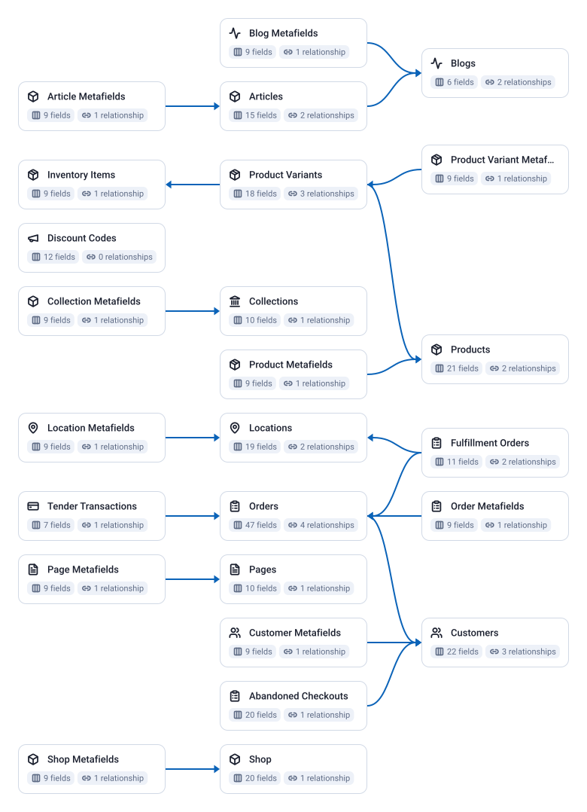

25 tables, 337 fields, 18 joins.

| Data Mart | Fields | Description |
|-----------|--------|-------------|
| [Abandoned Checkouts](./abandoned-checkouts.md) | 20 | Checkout sessions that did not complete — customer info, items, and pricing for recovery campaigns. |
| [Article Metafields](./article-metafields.md) | 9 | Custom metadata attached to articles — namespace, key, value, and type. |
| [Articles](./articles.md) | 15 | Blog articles — title, author, publication status, and timestamps. |
| [Blog Metafields](./blog-metafields.md) | 9 | Custom metadata attached to blogs — namespace, key, value, and type. |
| [Blogs](./blogs.md) | 6 | Blogs in the store — title, handle, and template settings. |
| [Collection Metafields](./collection-metafields.md) | 9 | Custom metadata attached to collections — namespace, key, value, and type. |
| [Collections](./collections.md) | 10 | Product collections — title, sort order, product count, and last updated. |
| [Customer Metafields](./customer-metafields.md) | 9 | Custom metadata attached to customers — namespace, key, value, and type. |
| [Customers](./customers.md) | 22 | Customer accounts — contact info, marketing consent, order history, and lifetime spend. |
| [Discount Codes](./discount-codes.md) | 12 | Discount codes — type, status, usage limits, and validity window. |
| [Fulfillment Orders](./fulfillment-orders.md) | 11 | Fulfillment orders — items to ship, assigned location, delivery method, and status. |
| [Inventory Items](./inventory-items.md) | 9 | Inventory items (SKUs) — tracking status, shipping requirements, and country of origin. |
| [Location Metafields](./location-metafields.md) | 9 | Custom metadata attached to locations — namespace, key, value, and type. |
| [Locations](./locations.md) | 19 | Physical and virtual store locations — activity status, fulfillment capabilities, and address. |
| [Order Metafields](./order-metafields.md) | 9 | Custom metadata attached to orders — namespace, key, value, and type. |
| [Orders](./orders.md) | 47 | Orders placed in the store — financial and fulfillment status, customer info, totals, and timestamps. |
| [Page Metafields](./page-metafields.md) | 9 | Custom metadata attached to pages — namespace, key, value, and type. |
| [Pages](./pages.md) | 10 | Static store pages — title, handle, publication status, and timestamps. |
| [Product Metafields](./product-metafields.md) | 9 | Custom metadata attached to products — namespace, key, value, and type. |
| [Product Variant Metafields](./product-variant-metafields.md) | 9 | Custom metadata attached to product variants — namespace, key, value, and type. |
| [Product Variants](./product-variants.md) | 18 | Product variants — SKU, price, inventory quantity, and availability. |
| [Products](./products.md) | 21 | Products in the store catalog — vendor, type, status, inventory, and price range. |
| [Shop](./shop.md) | 20 | Store settings — domain, currency, timezone, and plan details. |
| [Shop Metafields](./shop-metafields.md) | 9 | Custom metadata attached to the shop — namespace, key, value, and type. |
| [Tender Transactions](./tender-transactions.md) | 7 | Payment tender transactions — amount, currency, order reference, and processing time. |

# Example Questions

- How do orders, refunds and discounts add up to net sales per month and per customer?
- Which customers placed repeat orders, and which started a checkout they never finished?
- Which products and variants sell, and what stock record and location stand behind them?

# Explore this model

**[▶ Explore on canvas](https://model.owox.com/?okf=https://github.com/OWOX/models/tree/main/bundles/sources/shopify)**

One click opens this model in a free OWOX canvas you can poke around in — no account needed.

## Model preview

