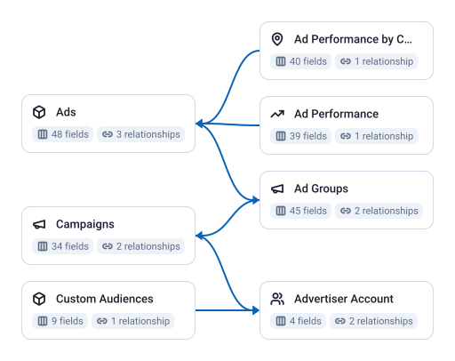

<!-- OWOX:GENERATED:START — regenerated on export, do not edit inside this block -->

**Authors:** [Ievgen Krasovytskyi](https://github.com/ikrasovytskyi)

| Data Mart | Fields | Last updated | Description |
|-----------|--------|--------------|-------------|
| [Ad Groups](./ad-groups.md) | 45 | 2026-05-29 | One row per ad group: its name, the campaign it sits in (`campaign_id` and `campaign_name`), status, budget and budget mode, bid type and bid price, optimization goal and event, placements, and targeting such as gender, age groups, languages, locations and audience IDs. |
| [Ad Performance](./ad-performance.md) | 39 | 2026-07-17 | Daily ad performance: impressions, clicks, spend, click-through rate, reach, frequency, conversions with cost per conversion and conversion rate, video play and completion-point views (2s, 6s, 25%, 50%, 75%, 100%), and profile visits, likes, comments, shares and follows. |
| [Ad Performance by Country](./ad-performance-by-country.md) | 40 | 2026-07-17 | Daily ad performance split by country: the same impressions, clicks, spend, conversion and video metrics as Ad Performance, with `country_code` (a two-letter ISO country code) added to the key. |
| [Ads](./ads.md) | 48 | 2026-09-28 | One row per ad: its name and status, the campaign and ad group it belongs to (`campaign_id`, `adgroup_id` and their names), and the creative: creative type, ad format, ad text, call to action, video and image IDs, landing page URL, deep link and tracking URLs. |
| [Advertiser Account](./advertiser-account.md) | 4 | 2026-05-29 | One row per advertiser account listed in the connector's Advertiser IDs: the advertiser ID, its name, company name and account currency. |
| [Campaigns](./campaigns.md) | 34 | 2026-05-29 | One row per campaign: its name, objective and objective type, campaign type, operation and secondary status, budget and budget mode, bid type, and create and modify times. |
| [Custom Audiences](./custom-audiences.md) | 9 | 2026-05-29 | One row per custom audience of an advertiser: its ID and name, audience type, coverage (`cover_num`, the number of matched users on TikTok), when it was created, whether it is valid and expiring, and when it expires. |

# Example Questions

- Which `campaigns` spend the most for the fewest conversions, once spend is divided by conversions?
- How do spend and click-through rate change from `campaign` to `ad group` to ad for the same objective?
- Which countries do ads spend in, and which of them convert?

# Explore this model

**[▶ Explore on canvas](https://model.owox.com/?okf=https://github.com/OWOX/models/tree/main/bundles/sources/tiktok-ads)**

One click opens this model in a free OWOX canvas you can poke around in — no account needed.

<!-- OWOX:GENERATED:END -->

## Model preview

