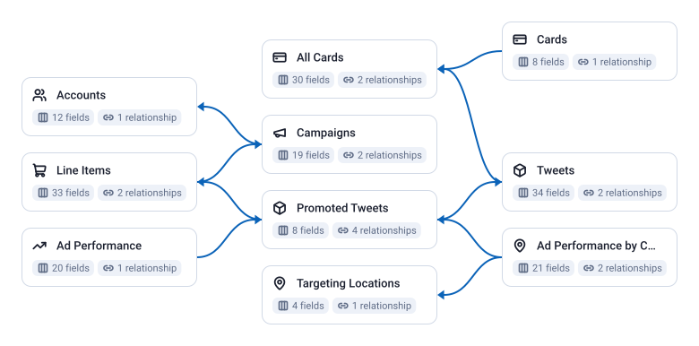

10 tables, 187 fields, 9 joins.

| Data Mart | Fields | Description |
|-----------|--------|-------------|
| [Accounts](./accounts.md) | 12 | Advertising accounts — name, business, country, timezone, and approval status. |
| [Ad Performance](./ad-performance.md) | 20 | Daily ad performance by placement — impressions, clicks, spend, engagements, and social actions. |
| [Ad Performance by Country](./ad-performance-by-country.md) | 21 | Daily ad performance broken down by country — impressions, clicks, spend, engagements, and social actions. |
| [All Cards](./all-cards.md) | 28 | All card types with full creative details — type, title, destination URL, call to action, and media. |
| [Campaigns](./campaigns.md) | 19 | Your campaigns — status, budget optimization, daily and total budget, and currency. |
| [Cards](./cards.md) | 8 | Website and app cards — type, URI, and components. |
| [Line Items](./line-items.md) | 33 | Line items within campaigns — bid strategy, goal, product type, budget, and schedule. |
| [Promoted Tweets](./promoted-tweets.md) | 8 | Tweets promoted as ads — status, approval, and links to their tweets and line items. |
| [Targeting Locations](./targeting-locations.md) | 4 | Reference table of location IDs with names and country codes — join targeting_value with the country field in Ad Performance by Country. |
| [Tweets](./tweets.md) | 34 | Original tweets used as ad creatives — text, type, language, engagement counts, and card URI. |

# Example Questions

- Which campaigns spend the most for the fewest clicks, once spend is divided by clicks?
- How do impressions, clicks and engagements change from campaign to line item to promoted tweet?
- Which countries do promoted tweets reach, and which of them engage?

# Explore this model

**[▶ Explore on canvas](https://model.owox.com/?okf=https://github.com/OWOX/models/tree/main/bundles/sources/x-ads)**

One click opens this model in a free OWOX canvas you can poke around in — no account needed.

## Model preview

