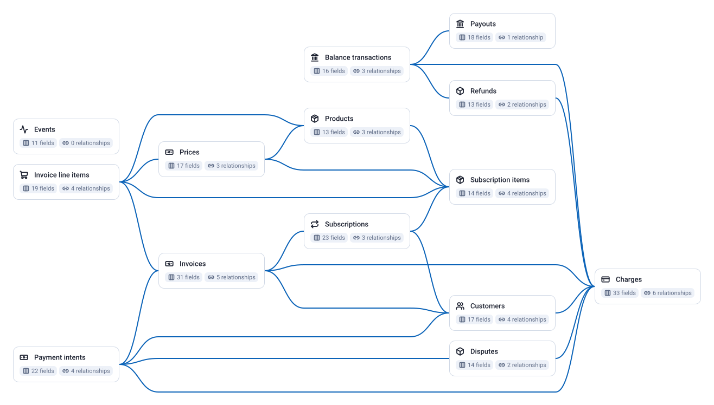

<!-- OWOX:GENERATED:START — regenerated on export, do not edit inside this block -->

| Data Mart | Fields | Description |
|-----------|--------|-------------|
| [Balance transactions](./balance-transactions.md) | 16 | Every movement of money through the Stripe balance: charges, refunds, disputes, fees, payouts, adjustments. |
| [Charges](./charges.md) | 33 | One row per charge attempt with amount, outcome, card details and the customer, invoice and payment intent it belongs to. |
| [Refunds](./refunds.md) | 13 | Money returned to customers: how much, on which charge, why, and the balance transaction that reversed it. |
| [Disputes](./disputes.md) | 14 | Chargebacks: disputed amount, reason, status and the evidence deadline. |
| [Payouts](./payouts.md) | 18 | Transfers from the Stripe balance to the bank account with the arrival date. |
| [Customers](./customers.md) | 17 | Every customer: identity, billing country, delinquency and account balance. |
| [Invoices](./invoices.md) | 31 | One row per invoice with amounts, status, period and payment. |
| [Invoice line items](./invoice-line-items.md) | 19 | Every line on every invoice: what was billed, for which price and product, for which period. |
| [Subscriptions](./subscriptions.md) | 23 | One row per subscription in any status with its period, trial and cancellation facts. |
| [Subscription items](./subscription-items.md) | 14 | The lines of every subscription: price and quantity. |
| [Products](./products.md) | 13 | The catalogue: every product, active or not. |
| [Prices](./prices.md) | 17 | Every price (plan) of every product: amount, currency, billing interval, active flag. |
| [Payment intents](./payment-intents.md) | 22 | Every payment attempt lifecycle: amount asked, amount received, status and last error. |
| [Events](./events.md) | 11 | The audit trail: every change Stripe recorded, typed, with the id of the object it concerns. |

# Example Questions

- How much did we net after fees, refunds and disputes last month, and did every `payout` reach the bank for the amount its `balance transactions` add up to?
- What is MRR today from `subscription items` × `prices`, and how did it move: new, expansion, contraction, churn?
- Which `customers` and `invoices` are past due or failing payment, and how much revenue is at risk?

# Explore this model

**[▶ Explore on canvas](https://model.owox.com/?okf=https://github.com/OWOX/models/tree/main/bundles/stripe)**

One click opens this model in a free OWOX canvas you can poke around in — no account needed.

<!-- OWOX:GENERATED:END -->

## Model preview

