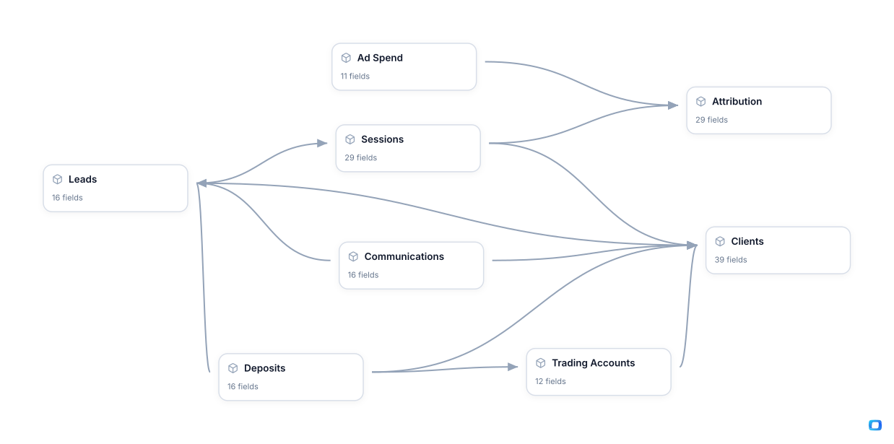

<!-- OWOX:GENERATED:START — regenerated on export, do not edit inside this block -->

**Authors:** [Vlad Flaks](https://github.com/vladflaks), [Rus Obolonsky](https://github.com/Obolrus)

| Data Mart | Fields |
|-----------|--------|
| [Ad Spend](./ad-spend.md) | 11 |
| [Attribution](./attribution.md) | 29 |
| [Clients](./clients.md) | 39 |
| [Communications](./communications.md) | 16 |
| [Deposits](./deposits.md) | 16 |
| [Leads](./leads.md) | 16 |
| [Sessions](./sessions.md) | 29 |
| [Trading Accounts](./trading-accounts.md) | 12 |

# Example Questions

- Which channels buy traders worth keeping rather than merely cheap ones — do the campaigns with the lowest cost per `first deposit` produce the `clients` who end up as champions with real lifetime value, or the ones who deposit once and go dormant?
- Does the desk change the outcome — do the `leads` someone managed to reach `deposit` more often, and sooner, than the ones that were never answered?
- Which acquisition regions return more `deposit volume` than they consume in budget, and how much of that money is withdrawn again within a few months?

# Explore this model

**[▶ Explore on canvas](https://model.owox.com/?okf=https://github.com/OWOX/models/tree/main/bundles/trading)**

One click opens this model in a free OWOX canvas you can poke around in — no account needed.

<!-- OWOX:GENERATED:END -->

## Model preview

